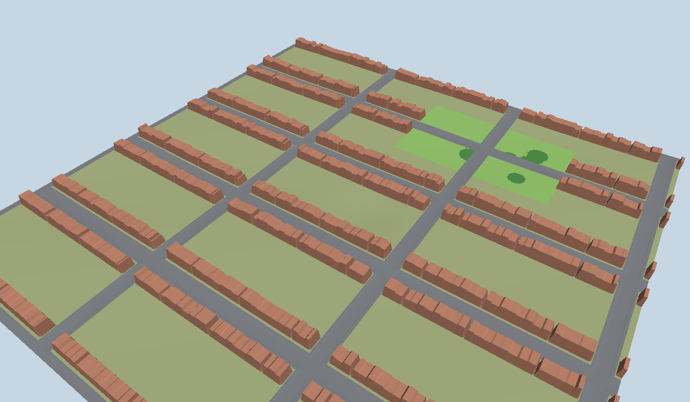
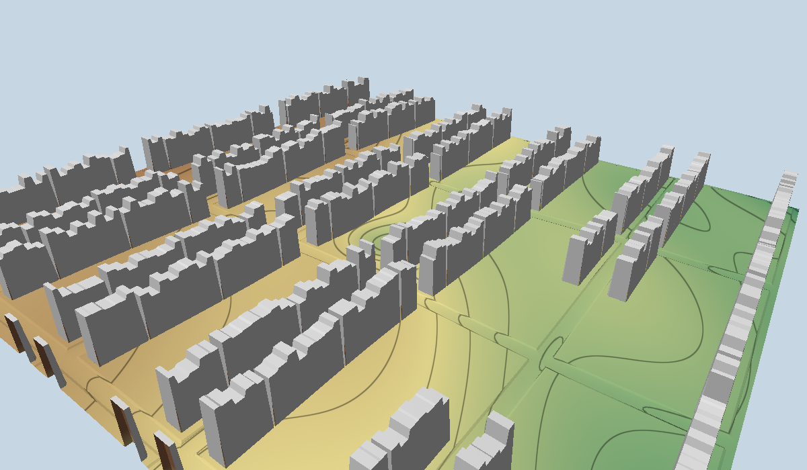

# Neighbourhood Flood Simulator

An interactive, browser-based simulation of surface water flooding in a real
neighbourhood in Reading, England. It is built from Environment Agency LiDAR and
Ordnance Survey open data and runs on the GPU with WebGPU.




**Status: Phase 1 (terrain and data pipeline).** The images show the built-in synthetic
neighbourhood. Water arrives in Phase 2. See [docs/PLAN.md](docs/PLAN.md) for the roadmap:
local inertial solver, design storms, radar replay, and Met Office ensemble forecasts.

## Repository layout

| Path | What |
|---|---|
| `preprocess/` | `wsim-prep`, a Python package turning EA LiDAR + OS vectors into simulation grids |
| `web/` | Vite + TypeScript + WebGPU viewer (and soon, solver) |
| `docs/PLAN.md` | Goals, architecture, modelling choices, phased roadmap |
| `docs/DATA_FORMAT.md` | The grid format shared by Python and the browser |
| `docs/GETTING_REAL_DATA.md` | How to download and build the real Reading scene |

## Quick start

Requirements: [uv](https://docs.astral.sh/uv/), Node.js 20+, and a WebGPU-capable
browser (recent Chrome, Edge, Safari or Firefox).

```bash
# Browser app (the synthetic scene is committed, so this works straight away)
cd web
npm install
npm run dev            # http://localhost:5173

# Python pipeline
cd preprocess
uv sync
uv run wsim-prep synthetic --out ../web/public/data/synthetic
```

Controls: drag to orbit, right-drag or shift-drag to pan, scroll or pinch to zoom.
Hover to read British National Grid coordinates, ground level and building height.

`web/snapshot.html?scene=synthetic&mode=elevation&vscale=3` renders a scene offscreen
to a PNG (used for the images above; it works where a WebGPU canvas cannot present,
such as headless browsers).

## Checks

```bash
cd preprocess && uv run ruff check . && uv run ruff format --check . && uv run pytest
cd web && npm run typecheck && npm test && npm run build
```

## Data licences

Real scenes use data under the Open Government Licence:
Contains Environment Agency information © Environment Agency and database right.
Contains OS data © Crown copyright and database right.
